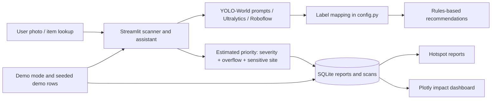

# WasteVision AI

**Smart waste intelligence platform** — a Streamlit prototype that turns waste photos into sorting guidance and actionable cleanup reports. Hotspot reports receive a transparent priority estimate based on detected items, category variety, reporter-rated visible severity, overflow/dumping, and sensitive-site proximity. The estimate supports triage and is not an official hazard assessment.

## Run it

Requires Python 3.10 or newer; Python 3.12 is recommended for the pinned dependency set.

```bash
python -m venv .venv
# Windows PowerShell: .venv\Scripts\Activate.ps1
# macOS/Linux: source .venv/bin/activate
python -m pip install -r requirements.txt
streamlit run app.py
```

The app creates `wastevision.db` and seeds 15 clearly labeled sample hotspot reports plus sample scan counts on first run. Enable **Demo mode** in the sidebar to use synthetic detections marked **DEMO DATA - not model output**. Demo report locations and images are illustrative; seed locations are around Mumbai and should not be treated as verified observations. Model inference runs only when Demo mode is off and the user starts a scan.

## Model configuration

The default adapter uses Ultralytics YOLO-World with a waste-focused open vocabulary (`yolov8s-worldv2.pt`), larger inference images, and test-time augmentation. Prompts target common bottles, bags, wrappers, cardboard, cans, glass, food scraps, and visible litter. This covers more waste-like objects than the old general `yolov8n.pt` COCO detector, but it is not a waste-trained or validated sorting model. The first real scan downloads the model if it is not cached; use Demo mode for an offline presentation. For production-level waste recognition, set `WASTEVISION_MODEL_PATH` to compatible weights trained on waste images and keep `WASTEVISION_MODEL_PROVIDER=ultralytics`.

To use a Roboflow-hosted model, set:

```bash
WASTEVISION_MODEL_PROVIDER=roboflow
ROBOFLOW_API_KEY=your_key
ROBOFLOW_MODEL_ID=project/1
```

Install the pinned `inference-sdk` dependency. The adapter normalizes both providers to the same output format. Add or edit raw label aliases in `CLASS_MAPPING` in `config.py`; labels without a waste mapping are ignored to prevent false waste detections. YOLO-World prompts and their output categories are editable through `WORLD_PROMPTS` in the same file. Adjust per-machine environment variables before launching Streamlit.

## Two-minute demo flow

1. On Home, point out the four paths from recognition to impact and the response signal. Turn on **Demo mode**.
2. Open **AI Waste Scanner**, upload any JPG/PNG photo, and show the explicitly labeled sample boxes, categories, confidence table, and next action.
3. Open **Smart Segregation**, type “greasy cardboard box” or “food scraps,” and show the disposal route. Unknown descriptions are clearly marked as a cautious fallback.
4. Open **Report Waste**, upload a public-area photo, enter a location, rate visible severity, and mark overflow or sensitive-site proximity if appropriate. Review the score breakdown and its triage-only disclaimer. The report is marked demo when demo mode is on.
5. Open **Impact Dashboard** to show the response queue, source filter, urgency/material/status/trend charts, and sample hotspot pins. Update a report status from **Report Waste** to demonstrate resolution tracking.

## Architecture



## Pitch notes

- **Problem:** Waste is often mixed or left in public places, reducing recovery and increasing landfill and hygiene risks.
- **Solution:** A photo-first tool that classifies visible waste, gives plain-language disposal guidance, and records cleanup hotspots.
- **Differentiator:** Recognition immediately leads to an action: sort the item, file a prioritized report, and track its resolution.
- **Expected impact:** Faster reporting and clearer sorting can help communities direct cleanup attention and improve source segregation. This prototype does not measure real-world outcomes.

## Limitations and assumptions

- The default open-vocabulary model can still confuse waste with reusable objects and miss small or obscured litter. Results depend on prompts, image quality, and local waste rules. Open-vocabulary inference is not a substitute for a waste-specific trained model.
- Demo detections, scan counts, sample reports, and sample coordinates are illustrative only. The database is local to the app process and intended for a single-user prototype; there is no authentication, moderation, or multi-user synchronization.
- Hotspot geocoding is not included; coordinates are entered manually. Map tiles need network access. A blank/zero coordinate is treated as missing.
- Photos are saved under `uploads/`; SQLite stores their relative paths. This prototype has no retention controls or sensitive-image safeguards.
- Sorting rules are intentionally broad; local authorities may accept different materials.
- Unknown model labels are ignored until mapped in `CLASS_MAPPING`; unknown typed item descriptions receive a clearly labeled residual-waste fallback. The six requested categories are the only normalized categories.

## Project layout

`app.py` is the entry point. Page logic is in `modules/`; model, recommendation, priority, and persistence logic is in `core/`. `data/demo_data.csv` documents the sample report data, while first-run SQLite seeding is implemented in `core/db.py`. `sample_images/` is reserved for optional local demo photos.
